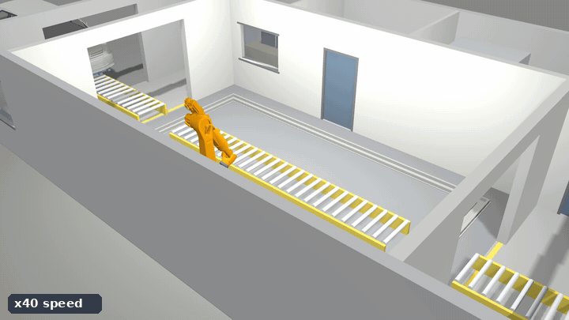
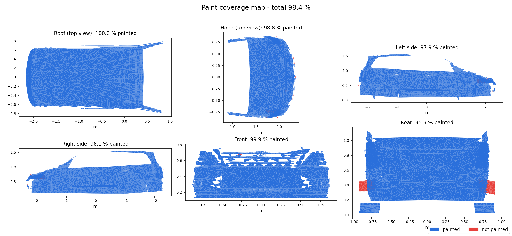
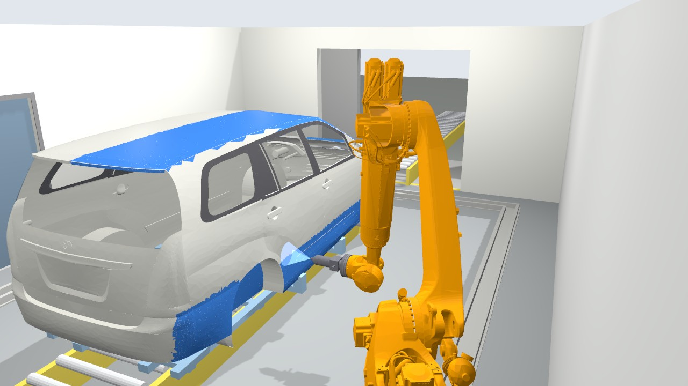
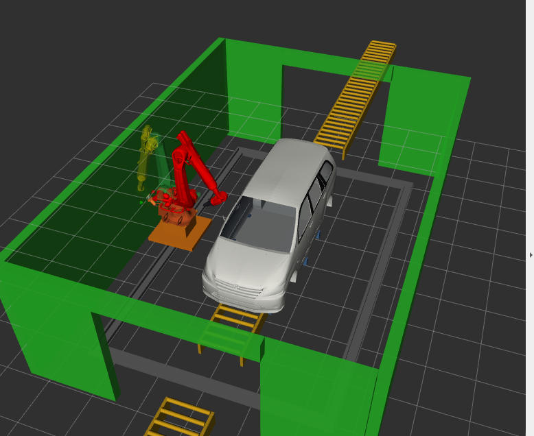

# Robotic Car Painting Cell

Simulation of an automated paint booth: a car body enters on a skid conveyor, an industrial robot on a floor
track paints its exterior (front, hood, roof, both sides, rear), and the painted body leaves through the exit.
Every motion is planned with collision checking and executed by ROS 2 controllers in a physics simulation.

- **Name:** Eyob Shimelis
- **Software used:** ROS 2 Jazzy, MoveIt 2, Gazebo Harmonic, RViz 2, SolidWorks, Python
- **Robot selected:** KUKA KR 210 R3100-2 on a 2-axis floor track (7th axis)



*The full painting cycle at 40x speed.*

## Demo video

The full demo video (5 min) is on [Google Drive](https://drive.google.com/file/d/1BJIOXkFf0frJrz-VCAx8JcS1W-pGkB8A/view?usp=drive_link).

All submission files (report, simulation files with CAD, screenshots, video): [Google Drive folder](https://drive.google.com/drive/folders/1BmRnFciEOvqbQ_sBYgk-fUvMSZPNPvJX?usp=sharing).

## Results

| | |
|---|---|
| Painted surfaces | front, hood, roof, right side, rear, left side (18.6 m²) |
| Paint coverage | **98.4 %** |
| Cycle time | 990 s (simulated), car in to car out |
| Spray path | 127 m, gun 0.25 m from the surface at 0.4 m/s |
| Reachability | 98.7–100 % of the spray points on every pass |



More detail, figures and the per-panel table are in the [technical report](report/Technical_Report.pdf).

## Repository structure

```
robotic_paint_cell/
├── paint_cell_ws/src/
│   ├── paint_cell_description/    URDF of the cell: robot, track, conveyor, skid, car, spray gun; meshes
│   ├── paint_cell_moveit_config/  MoveIt 2: planning groups, limits, controllers, booth walls
│   ├── paint_cell_gazebo/         Gazebo world (paint booth) and launch with ros2_control
│   └── paint_cell_planner/        paint paths, touch-ups, motion sequence, paint effect, result figures
├── report/                        technical report, figures and results of the final run
└── media/                         screenshots and the demo preview
```

## Requirements

Ubuntu 24.04, ROS 2 Jazzy, Gazebo Harmonic.

```bash
sudo apt install ros-jazzy-moveit ros-jazzy-ros2-control ros-jazzy-ros2-controllers \
                 ros-jazzy-ros-gz ros-jazzy-gz-ros2-control ros-jazzy-kuka-robot-descriptions \
                 ros-jazzy-xacro ros-jazzy-joint-state-publisher-gui \
                 python3-numpy python3-scipy python3-matplotlib python3-yaml
```

## Build and run

```bash
cd paint_cell_ws
colcon build --symlink-install
source install/setup.bash
```

| Command | What it does |
|---|---|
| `ros2 launch paint_cell_planner paint_demo.launch.py` | Full demo in Gazebo: the car enters, the robot paints all panels, the car leaves |
| `ros2 launch paint_cell_planner paint_demo.launch.py zones:="[roof,hood]"` | Paint only some panels (`front`, `hood`, `roof`, `right_side`, `rear`, `left_side`) |
| `ros2 launch paint_cell_gazebo gazebo.launch.py` | Gazebo + MoveIt + RViz, for planning by hand |
| `ros2 launch paint_cell_moveit_config demo.launch.py` | MoveIt + RViz without Gazebo (collision checking demo) |
| `ros2 launch paint_cell_description display.launch.py` | Robot model in RViz with joint sliders |

The paint job plans all paths before the car enters (a few minutes), then runs the cycle. Results are written
to `paint_results/` (tables, coverage map, cycle-time chart). Paint parameters (speed, stripe spacing, tilt
limits, job order) are in `paint_cell_planner/config/paint_job.yaml`.

## How it works

- **Cell:** booth 9.5 x 6.5 m with entry and exit zones (based on the reference layout, enlarged after a reach
  study). The car body rides on a skid conveyor; the robot stands on a carriage on a loop track around it.
- **Paint paths:** parallel stripes 0.15 m apart are laid over each panel by casting rays onto the car surface;
  the gun follows the surface normal (tilt at most 20°) and switches off over the windows.
- **Motion:** the track follows the gun along each stripe while MoveIt's collision-aware IK solves the arm for
  every waypoint; paths are timed for a constant gun speed within the joint limits. Every pass has an approach
  and a retract point.
- **Touch-ups:** the spray of the planned passes is simulated, and the spots it misses get short extra strokes.
- **Collision checking:** robot and gun against the car, skid, conveyor, track, booth walls and itself, for every
  waypoint and every planned move.
- **Route:** joint 1 is limited to ±185° and the walls are close behind the track, so the robot works
  front → near side → rear → far side and returns, instead of circling the car.

<p>
  
  
</p>

## Credits

- Robot model: KUKA's official ROS 2 package [kuka_robot_descriptions](https://github.com/kroshu/kuka_robot_descriptions) (Apache-2.0).
- Car body: Toyota Innova 3D model from [GrabCAD](https://grabcad.com/), cleaned, scaled and split into paint panels.
- Music in the demo video: J. S. Bach, Preludes BWV 846 and 847, performed by Kimiko Ishizaka
  ([Open Well-Tempered Clavier](https://commons.wikimedia.org/wiki/File:Kimiko_Ishizaka_-_Bach_-_Well-Tempered_Clavier,_Book_1_-_01_Prelude_No._1_in_C_major,_BWV_846.ogg), CC0 public domain).

## License

[Apache License 2.0](LICENSE)
